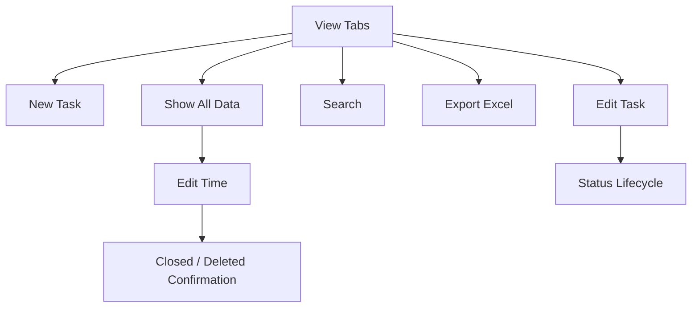

# PRD 文档

## 0. 文档信息

| 字段 | 内容 |
|------|------|
| 产品名称 | Task Tracker |
| 版本 | Phase 1 PRD |
| 负责人 | Product / Project Team |
| 来源定型稿 | 01-产品定义/06-最终定型稿.md |
| UI 设计基准 | shadcn/ui |
| 开发目标 | Vibe.Power Apps |
| 最后更新时间 | 2026-10-07 |

## 1. 项目背景与范围

### 1.1 背景

Task Tracker 是一个独立 Web App，用于记录、跟进和每周汇报工作任务。产品采用 Single Page HTML + JavaScript、SQLite 与 DataTables，提供 Microsoft Lists / Power Apps 风格的任务表格体验。

本 PRD 以冻结版产品定型稿为主要事实来源。

### 1.2 目标

- 建立统一的 Task 记录方式。
- 支持 Task 建立、编辑、状态管理及历史查看。
- 支持 Weekly Task 与 Current Week Status 周期性工作查看。
- 支持 Customer 管理。
- 支持 REST API Task CRUD。
- 支持当前 View Excel Export。
- 支持 Show All Data 的 Edit Time，以修正 Created / End 并维持 End 与 Status 一致。
- 由 Vibe.Power Apps 负责后续开发落地。
- UI 采用 shadcn/ui 作为主要设计与组件基准。

### 1.3 成功指标

Phase 1 应至少满足：

1. 用户能够建立并维护 Task。
2. Weekly Task 与 Current Week Status 能按既定规则正确显示。
3. Deleted Task 不从数据库物理删除，并可通过 Show All Data 恢复。
4. Customer 可在 Task 流程内维护，最多16个且颜色唯一。
5. REST API 能完成 Task CRUD。
6. 每个 View 能导出当前显示结果。
7. Edit Time 不产生 Active Status + non-empty End 的不一致数据。
8. UI 与交互符合已选定的 shadcn/ui 设计体系。
9. PRD 能作为 Vibe.Power Apps 的实现依据。

### 1.4 MVP 范围

- Task Management
- Weekly Task
- Current Week Status
- Show All Data
- Global Search
- Customer Add/Edit
- REST API Task CRUD
- Excel Export
- Show All Data Edit Time

### 1.5 暂缓范围

- Phase 2
- Bulk Action
- 独立 Customer Management 页面
- Physical Delete
- 复杂权限体系

## 2. 用户与场景

### 2.1 用户角色

Phase 1 不定义复杂权限体系。

| 用户/对象 | 说明 |
|-----------|------|
| Task 使用者 | 建立、编辑、查看、搜索和导出 Task |
| 外部调用方 | 通过 REST API 进行 Task CRUD |
| Vibe.Power Apps | Phase 1 的开发实现方 |

### 2.2 核心场景

1. 建立 Task。
2. 编辑 Task 并自动保存。
3. 查看 Weekly Task。
4. 查看 Current Week Status。
5. 搜索全部历史 Task。
6. Add/Edit Customer。
7. 使用 REST API 操作 Task。
8. 导出当前 View。
9. 使用 Edit Time 修正 Created / End。

### 2.3 用户故事

- 作为 Task 使用者，我希望快速建立 Task，以记录工作事项。
- 作为 Task 使用者，我希望编辑 Task 后自动保存，减少重复操作。
- 作为 Task 使用者，我希望查看本周新任务及历史未完成任务。
- 作为 Task 使用者，我希望按当前周的 Status 查看任务分布。
- 作为 Task 使用者，我希望搜索历史 Task。
- 作为 Task 使用者，我希望在需要时维护 Customer。
- 作为 Task 使用者，我希望导出当前 View 供周报或其他用途使用。
- 作为 Task 使用者，我希望在 Show All Data 修正 Created / End，并由系统保证 End 与 Status 一致。

## 3. 产品流程总览

## 4. UI 与开发基准

### 4.1 UI Design System

Phase 1 UI 以 **shadcn/ui** 为主要设计与组件基准。

要求：

- 优先使用 shadcn/ui 提供的组件与设计模式。
- 保持整体视觉、间距、Typography、表单、Dialog、Button、Dropdown、Table、Tabs、Badge 等组件的一致性。
- 允许根据 Task Tracker 需求进行组件组合与样式定制。
- UI 不以旧式 Microsoft Lists / Power Apps 视觉作为最终设计规范；Microsoft Lists / Power Apps 仅作为业务使用方式和信息密度的参考。
- 后续 Prototype 与 Development 应以 shadcn/ui 当前官方设计体系为准。

shadcn/ui 官方文档：urlshadcn/uihttps://ui.shadcn.com

### 4.2 Development Target

Phase 1 的实际开发目标为 **Vibe.Power Apps**。

PRD 应：

- 使用清晰、可实现的 UI 与交互描述。
- 明确页面、组件、状态、数据和验收行为。
- 避免依赖只存在于设计稿中的隐性行为。
- 让 Vibe.Power Apps 能根据 PRD 直接实现和验证功能。

## 5. 模块概览

| ID | 模块 | 范围 |
|----|------|------|
| F01 | Task Management | Task 建立、编辑、状态与自动保存 |
| F02 | Task Views & Search | 三个 View 与 Global Search |
| F03 | Customer Management | Customer Add/Edit 与固定颜色 |
| F04 | Task Time Management | Edit Time 与 End/Status 一致性 |
| F05 | Integration & Export | REST API 与 Excel Export |

## 6. 功能需求

> 本章节按模块逐模块追加。模块正文将在对应模块评审后继续写入。

### 6.1 F01 Task Management

待进入 F01 模块详细评审。

### 6.2 F02 Task Views & Search

待进入 F02 模块详细评审。

### 6.3 F03 Customer Management

待进入 F03 模块详细评审。

### 6.4 F04 Task Time Management

待进入 F04 模块详细评审。

### 6.5 F05 Integration & Export

待进入 F05 模块详细评审。

## 7. 非功能需求

### 7.1 性能需求

Phase 1 暂不定义具体性能指标；后续若出现影响工程实现或验收的性能要求，应进入待决策事项。

### 7.2 时间与时区

系统业务时间统一使用 Malaysia Time (UTC+8)。

### 7.3 数据保留

Deleted Task 为 Logical Delete，Task 记录保留于 SQLite。

### 7.4 可维护性

系统采用 Single Page HTML + JavaScript、SQLite 和 DataTables 的独立 Web App 架构。

### 7.5 UI 一致性

UI 组件和交互模式应优先遵循 shadcn/ui，避免同一功能出现多套不一致的组件行为。

### 7.6 AI / Vibe Development Compatibility

PRD 的页面、组件、业务规则、状态、数据字段及验收标准应保持结构化、明确和可追溯，以便 Vibe.Power Apps 进行 AI-assisted implementation。

## 8. 数据埋点

Phase 1 未定义产品数据埋点需求。

## 9. 异常处理和风险

- Customer 达到16个后，不允许创建新的 Customer。
- Task 建立时 Customer 为必填。
- Active Task 使用 Edit Time 设置 End 时，必须完成 Closed / Deleted 选择。
- 不允许保存 Active Status + non-empty End 的不一致数据。
- Deleted Task 不显示在两个 Weekly Views，但必须保留于 Show All Data。
- Physical Delete 不属于 Phase 1。
- 未确认的新增业务规则不得直接写入正式功能正文。
- shadcn/ui 组件具体选型若影响工程实现，应在对应功能模块评审时明确。
