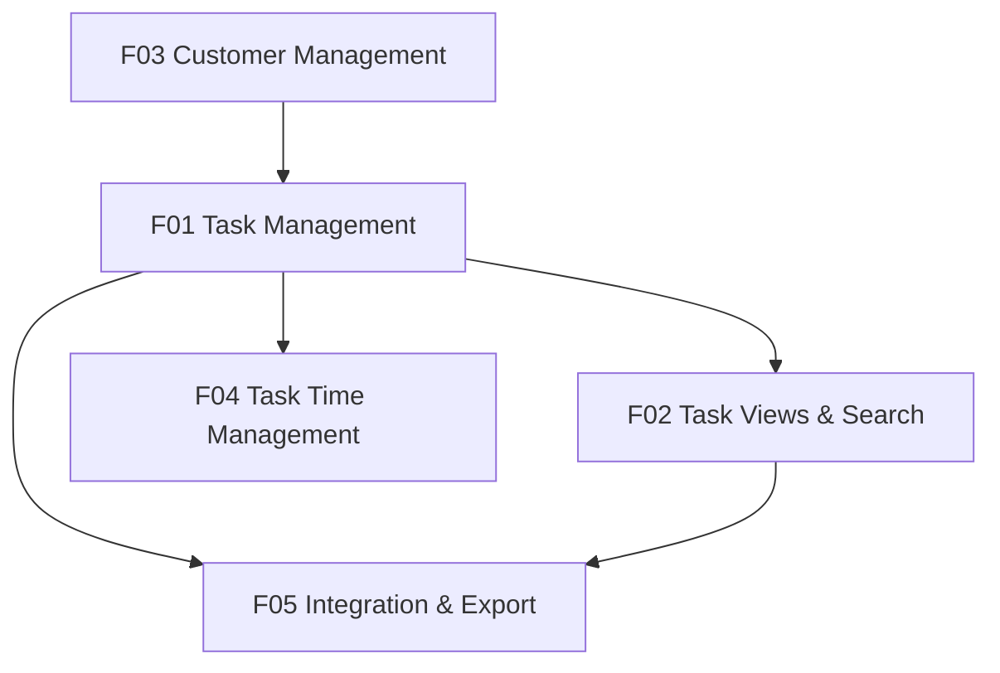

# 模块规划

## 规划依据

- 来源定型稿：01-产品定义/06-最终定型稿.md
- PRD 模板：PRD Make 默认模板
- 模块拆分原则：按用户流程、页面菜单、后台能力、外部接口、数据依赖和工程交付边界动态拆分。
- Phase 1 已确认 N01–N122，无 Open 问题。

## 模块清单

| ID | 模块 | 模块目标 | 范围 | 主要用户/对象 | 依赖 |
|----|------|----------|------|---------------|------|
| F01 | Task Management | 建立、编辑并管理 Task 生命周期 | New Task、Edit Task、Status、Auto Save、Task Lifecycle | Task 使用者 | F03 |
| F02 | Task Views & Search | 提供任务查看、分类、搜索能力 | Weekly Task、Current Week Status、Show All Data、Global Search | Task 使用者 | F01 |
| F03 | Customer Management | 管理 Task 所使用的 Customer | Customer Dropdown、Add Customer、Edit Customer、固定16色、不可删除 | Task 使用者 | 无 |
| F04 | Task Time Management | 在 Show All Data 修正 Task 时间并保持 End/Status 一致 | Edit Time、Created/End 修改、Warning、Closed/Deleted 确认 | Task 使用者 | F01、F02 |
| F05 | Integration & Export | 提供外部 Task CRUD 与当前 View 导出 | REST API、Excel Export | Task 使用者 / 外部调用方 | F01、F02 |

## 功能清单

| 页面/菜单 | 模块 | 功能 | 功能说明 |
|-----------|------|------|----------|
| New Task / Edit Task | F01 | Task CRUD | 建立、查看、编辑 Task；正常 Edit 不修改 Created/End |
| New Task / Edit Task | F01 | Status Lifecycle | 支持 WIP、Pending with Customer、KIV、Closed、Deleted 之间直接转换 |
| New Task / Edit Task | F01 | Auto Save | 编辑字段 Blur 后自动保存 |
| Weekly Task | F02 | Weekly Task View | 显示 Carry Over 与 New This Week |
| Current Week Status | F02 | Current Week Status View | 显示 WIP、Pending with Customer、KIV、Closed 四组 |
| Show All Data | F02 | All Data View | 显示全部记录，包括 Deleted，并支持 Pagination |
| All Views | F02 | Global Search | 搜索 Task ID、Customer Name、Task Title、Task Description、Note |
| New Task / Edit Task | F03 | Customer Selection | Customer 必须从 Dropdown 选择 |
| Customer Dropdown | F03 | Add Customer | + Add Customer，最多16个唯一颜色 Customer |
| Customer Dropdown | F03 | Edit Customer | 修改 Customer Name 与 Color，Blur 自动保存 |
| Show All Data | F04 | Edit Time | 修改 Created 与 End；Normal Edit 不允许修改 |
| Show All Data | F04 | End/Status Consistency | Active Task 设置 End 前 Warning；填写 End 后必须选择 Closed 或 Deleted |
| REST API | F05 | Task CRUD API | POST / GET / PATCH / DELETE Task |
| All Views | F05 | Excel Export | 导出当前 View / 当前结果为单 Sheet Excel |

## 模块依赖图

## 建议开发顺序

| 顺序 | 模块 | 原因 |
|------|------|------|
| 1 | F03 | Customer 是 Task 的数据依赖 |
| 2 | F01 | Task 是 Views、Edit Time、API 的核心数据基础 |
| 3 | F02 | 建立主要任务查看、筛选和搜索体验 |
| 4 | F04 | 基于 Task 与 Show All Data 实现时间修正及一致性规则 |
| 5 | F05 | 基于核心 Task/Views 提供 API 与 Excel Export |

## 可并行开发建议

- 可并行模块：F02 与 F04 可在 F01 数据结构稳定后并行；F05 可部分并行。
- 并行前提：Task 数据模型、Status、Customer 关系及核心 API/Data Access 规则已稳定。
- 不建议并行的模块及原因：F01 与 F03 不建议完全并行，因为 Task 建立依赖 Customer；F04 不应早于 F01/F02 的核心流程确定。

## 用户确认清单

- [x] 模块拆分已获得用户确认。
- [x] 页面/菜单功能覆盖完整。
- [x] 模块依赖明确。
- [x] 开发顺序符合 MVP 优先级。
- [x] 可并行模块已定义。

## 当前评审状态

已确认，可进入正式 PRD 写作。
