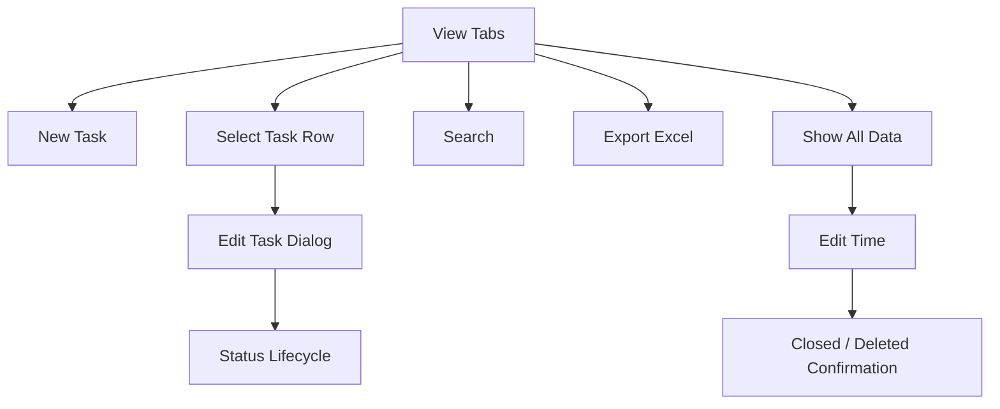
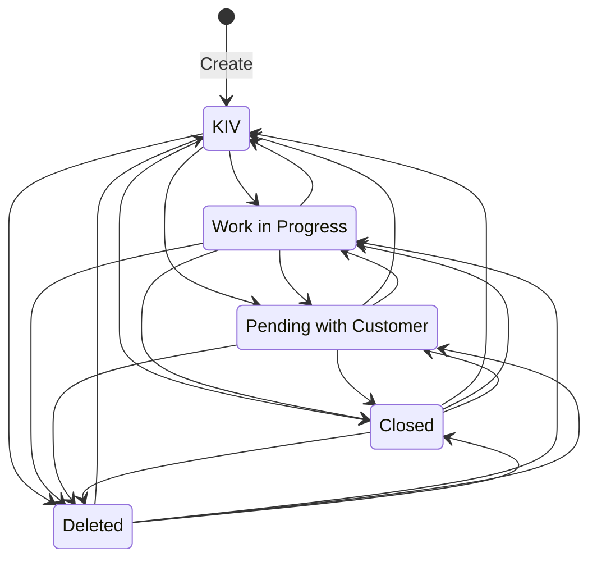

# PRD 文档

## 0. 文档信息

| 字段 | 内容 |
|------|------|
| 产品名称 | Task Tracker |
| 版本 | Phase 1 PRD |
| 负责人 | Product / Project Team |
| 来源定型稿 | Phase 1/01-产品定义/06-最终定型稿.md |
| UI 设计基准 | shadcn/ui |
| 开发目标 | Vibe.Power Apps |
| 最后更新时间 | 2026-10-15 |

## 1. 项目背景与范围

### 1.1 背景

Task Tracker 是一个独立 Web App，用于记录、跟进和每周汇报工作任务。产品采用 Single Page HTML + JavaScript、SQLite 与 DataTables，提供 Microsoft Lists / Power Apps 风格的任务表格体验。

本 PRD 以冻结版产品定型稿为主要事实来源。

### 1.2 目标

- 建立统一的 Task 记录方式。
- 支持 Task 建立、编辑、状态管理及历史查看。
- 支持 Weekly Task 与 Current Week Status 周期性工作查看。
- 支持 Customer 管理。
- 支持 REST API Task CRUD。
- 支持当前 View Excel Export。
- 支持 Show All Data 的 Edit Time，以修正 Created / End 并维持 End 与 Status 一致。
- 由 Vibe.Power Apps 负责后续开发落地。
- UI 采用 shadcn/ui 作为主要设计与组件基准。

### 1.3 成功指标

Phase 1 应至少满足：

1. 用户能够建立并维护 Task。
2. Weekly Task 与 Current Week Status 能按既定规则正确显示。
3. Deleted Task 不从数据库物理删除，并可通过 Show All Data 恢复。
4. Customer 可在 Task 流程内维护，最多16个且颜色唯一。
5. REST API 能完成 Task CRUD。
6. 每个 View 能导出当前显示结果。
7. Edit Time 不产生 Active Status + non-empty End 的不一致数据。
8. UI 与交互符合已选定的 shadcn/ui 设计体系。
9. PRD 能作为 Vibe.Power Apps 的实现依据。

### 1.4 MVP 范围

- Task Management
- Weekly Task
- Current Week Status
- Show All Data
- Global Search
- Customer Add/Edit
- REST API Task CRUD
- Excel Export
- Show All Data Edit Time

### 1.5 暂缓范围

- Phase 2
- Bulk Action
- 独立 Customer Management 页面
- Physical Delete
- 复杂权限体系

## 2. 用户与场景

### 2.1 用户角色

Phase 1 不定义复杂权限体系。

| 用户/对象 | 说明 |
|-----------|------|
| Task 使用者 | 建立、编辑、查看、搜索和导出 Task |
| 外部调用方 | 通过 REST API 进行 Task CRUD |
| Vibe.Power Apps | Phase 1 的开发实现方 |

### 2.2 核心场景

1. 建立 Task。
2. 编辑 Task 并自动保存。
3. 查看 Weekly Task。
4. 查看 Current Week Status。
5. 搜索全部历史 Task。
6. Add/Edit Customer。
7. 使用 REST API 操作 Task。
8. 导出当前 View。
9. 使用 Edit Time 修正 Created / End。

### 2.3 用户故事

- 作为 Task 使用者，我希望快速建立 Task，以记录工作事项。
- 作为 Task 使用者，我希望编辑 Task 后自动保存，减少重复操作。
- 作为 Task 使用者，我希望查看本周新任务及历史未完成任务。
- 作为 Task 使用者，我希望按当前周的 Status 查看任务分布。
- 作为 Task 使用者，我希望搜索历史 Task。
- 作为 Task 使用者，我希望在需要时维护 Customer。
- 作为 Task 使用者，我希望导出当前 View 供周报或其他用途使用。
- 作为 Task 使用者，我希望在 Show All Data 修正 Created / End，并由系统保证 End 与 Status 一致。

## 3. 产品流程总览



## 4. UI 与开发基准

### 4.1 UI Design System

Phase 1 UI 以 **shadcn/ui** 为主要设计与组件基准。

要求：

- 优先使用 shadcn/ui 提供的组件与设计模式。
- 保持整体视觉、间距、Typography、表单、Dialog、Button、Dropdown、Table、Tabs、Badge 等组件的一致性。
- 允许根据 Task Tracker 需求进行组件组合与样式定制。
- UI 不以旧式 Microsoft Lists / Power Apps 视觉作为最终设计规范；Microsoft Lists / Power Apps 仅作为业务使用方式和信息密度的参考。
- 后续 Prototype 与 Development 应以 shadcn/ui 当前官方设计体系为准。

shadcn/ui 官方文档：urlshadcn/uihttps://ui.shadcn.com

### 4.2 Development Target

Phase 1 的实际开发目标为 **Vibe.Power Apps**。

PRD 应：

- 使用清晰、可实现的 UI 与交互描述。
- 明确页面、组件、状态、数据和验收行为。
- 避免依赖只存在于设计稿中的隐性行为。
- 让 Vibe.Power Apps 能根据 PRD 直接实现和验证功能。

## 5. 模块概览

| ID | 模块 | 范围 |
|----|------|------|
| F01 | Task Management | Task 建立、编辑、状态与自动保存 |
| F02 | Task Views & Search | 三个 View 与 Global Search |
| F03 | Customer Management | Customer Add/Edit 与固定颜色 |
| F04 | Task Time Management | Edit Time 与 End/Status 一致性 |
| F05 | Integration & Export | REST API 与 Excel Export |

## 6. 功能需求

### 6.1 F01 Task Management

#### 6.1.1 F01-01 New Task

**1. 功能目标**

允许 Task 使用者建立 Task，并由系统生成 Task ID 与 Created 时间。

**2. 流程与页面交互**

| 页面/区域 | 入口 | 关键组件 | 退出/下一步 |
|-----------|------|----------|-------------|
| 当前 View | 点击 `+ New Task` | Button | 打开 New Task Dialog |
| New Task Dialog | 从当前 View 打开 | 居中 Dialog，宽度约 800px；表单字段；Create、Cancel、X | Create 成功后关闭并刷新当前列表；Cancel/X 关闭且不建立记录 |

**3. 状态说明**

| 状态 | 触发条件 | UI/系统行为 |
|------|----------|-------------|
| 编辑中 | 打开 New Task Dialog | 用户填写表单；尚未建立记录 |
| 验证失败 | 必填字段为空或输入不符合限制 | 显示字段验证提示，不建立记录 |
| 创建成功 | 用户点击 Create 且验证通过 | 保存 Task、关闭 Dialog、刷新当前 View |
| 已取消 | 用户点击 Cancel 或 X | 关闭 Dialog，不保存草稿、不建立记录 |

**4. 业务规则**

1. Customer Name 与 Task Title 为必填字段。
2. Task Title 为单行文本，最多 100 个字符。
3. Task Description 为可选单行文本，最多 255 个字符。
4. Note 为可选多行文本，最多 1000 个字符。
5. Status 默认值为 `KIV`。
6. Task ID 由系统生成，格式为 `TSK-0001`、`TSK-0002`，必须唯一、永久且不得重复使用。
7. Created 由系统以当前 Malaysia Time (UTC+8) 生成。
8. 新 Task 的 End 初始为 NULL。
9. New Task 不采用 Auto Save；只有点击 Create 且验证通过后才建立记录。
10. Customer 下拉列表及 Customer 新增/编辑行为由 F03 定义。

**5. 数据要求**

| 对象 | 字段 | 类型 | 必填 | 备注 |
|------|------|------|------|------|
| Task | Task ID | String | 是 | 系统生成；唯一、永久、不重复使用 |
| Task | Customer Name | String | 是 | 从 Customer 下拉列表选择；直接保存 Customer Name，不保存 Customer ID |
| Task | Task Title | String(100) | 是 | 单行 |
| Task | Task Description | String(255) | 否 | 单行 |
| Task | Note | String(1000) | 否 | 多行 |
| Task | Created | DateTime | 系统生成 | Malaysia Time UTC+8 |
| Task | End | Nullable DateTime | 否 | 初始为 NULL |
| Task | Status | Enum/String | 是 | 默认 KIV |

**6. 验收标准**

- [ ] AC-F01-01-01：点击 `+ New Task` 后，显示居中、约 800px 宽的 Dialog。
- [ ] AC-F01-01-02：Customer Name 或 Task Title 为空时，不允许创建，并显示验证提示。
- [ ] AC-F01-01-03：Task Title 超过 100 个字符时，系统阻止超限输入或拒绝提交并提示。
- [ ] AC-F01-01-04：Task Description 最多 255 个字符，Note 最多 1000 个字符。
- [ ] AC-F01-01-05：创建成功的 Task 获得唯一且按既定格式生成的 Task ID。
- [ ] AC-F01-01-06：新 Task 的 Status 为 KIV、Created 为当前 Malaysia Time、End 为 NULL。
- [ ] AC-F01-01-07：点击 Create 成功后 Dialog 关闭，当前列表刷新。
- [ ] AC-F01-01-08：点击 Cancel 或 X 后不建立 Task。

**7. 权限**

| 角色/对象 | 权限 | 说明 |
|-----------|------|------|
| Task 使用者 | Create | Phase 1 不定义复杂权限体系 |
| 外部调用方 | 不在本功能范围 | API 创建规则由 F05 定义 |

#### 6.1.2 F01-02 Edit Task

**1. 功能目标**

允许 Task 使用者编辑 Task 的业务字段，并在字段失焦时自动保存。

**2. 流程与页面交互**

| 页面/区域 | 入口 | 关键组件 | 退出/下一步 |
|-----------|------|----------|-------------|
| Task List Row | 点击整行 | 可点击数据行 | 打开该 Task 的 Edit Task Dialog |
| Edit Task Dialog | 点击 Task 行 | 居中 Dialog，宽度约 800px；可编辑字段；只读字段；X/Close | 字段 Blur 后保存；关闭后刷新当前列表 |

**3. 状态说明**

| 状态 | 触发条件 | UI/系统行为 |
|------|----------|-------------|
| 查看/编辑 | 打开已有 Task | 显示字段值；系统字段只读 |
| 字段已修改 | 用户更改可编辑字段 | 暂存该字段的输入值，等待 Blur |
| 保存中 | 修改字段发生 Blur | 保存该字段；避免重复提交同一未完成请求 |
| 保存成功 | 后端保存成功 | 显示已保存状态或采用不打断操作的反馈 |
| 保存失败 | 后端拒绝或请求失败 | 明确告知保存失败，不得静默丢弃；保留输入值并允许重试 |

**4. 业务规则**

1. 点击 Task 数据行打开 Edit Task Dialog。
2. 可编辑字段：Customer Name、Task Title、Task Description、Note、Status。
3. 只读字段：Task ID、Created、End。
4. 任一可编辑字段发生修改并 Blur 后，系统立即保存该字段。
5. 不提供 Save Button。
6. 点击 X/Close 直接关闭 Dialog，不额外显示 Save Confirmation。
7. 关闭 Dialog 后刷新当前 Task List。
8. Created 与 End 不可通过普通 Edit Task 修改；时间修正只能通过 F04 的 Edit Time。
9. Status 更新必须执行 F01-03 的 End 联动规则。
10. Customer 选择与维护规则由 F03 定义。

**5. 数据要求**

| 对象 | 字段 | 类型 | 必填 | 备注 |
|------|------|------|------|------|
| Task | Task ID | String | 是 | 只读 |
| Task | Customer Name | Customer reference | 是 | 可编辑 |
| Task | Task Title | String(100) | 是 | 可编辑 |
| Task | Task Description | String(255) | 否 | 可编辑 |
| Task | Note | String(1000) | 否 | 可编辑 |
| Task | Created | DateTime | 是 | 只读；仅 F04 可修正 |
| Task | End | Nullable DateTime | 否 | 只读；仅 F04 可修正 |
| Task | Status | Enum/String | 是 | 可编辑 |

**6. 验收标准**

- [ ] AC-F01-02-01：点击 Task 行后，打开对应 Task 的 Edit Task Dialog。
- [ ] AC-F01-02-02：Task ID、Created、End 显示为只读。
- [ ] AC-F01-02-03：Customer Name、Task Title、Task Description、Note、Status 可编辑。
- [ ] AC-F01-02-04：可编辑字段修改后 Blur，系统自动保存，不需要点击 Save。
- [ ] AC-F01-02-05：必填字段不符合规则时，不保存无效值，并向用户显示原因。
- [ ] AC-F01-02-06：保存失败时用户可见错误，输入值不会被静默丢弃。
- [ ] AC-F01-02-07：点击 X/Close 不显示 Save Confirmation；关闭后当前列表刷新。
- [ ] AC-F01-02-08：普通 Edit Task 不能修改 Created 或 End。

**7. 权限**

| 角色/对象 | 权限 | 说明 |
|-----------|------|------|
| Task 使用者 | View/Edit | Phase 1 不定义复杂权限体系 |
| 外部调用方 | 不在本功能范围 | API 更新规则由 F05 定义 |

#### 6.1.3 F01-03 Status Lifecycle

**1. 功能目标**

定义 Task 的状态集合、状态转换及 Status 与 End 字段之间必须维持的一致性。

**2. 流程与页面交互**

| 页面/区域 | 入口 | 关键组件 | 退出/下一步 |
|-----------|------|----------|-------------|
| New Task Dialog | 创建 Task | Status Select | 默认 KIV |
| Edit Task Dialog | 编辑 Task | Status Select | 选择新 Status 后按本功能规则保存 |
| Task List | 查看任务 | Status Badge | 显示当前 Status；具体 View 过滤由 F02 定义 |

**3. 状态说明**

| Status | 分类 | 进入该状态时的 End 行为 |
|--------|------|-------------------------|
| Work in Progress | Active | End 清为 NULL |
| Pending with Customer | Active | End 清为 NULL |
| KIV | Active | End 清为 NULL |
| Closed | Terminal-like business status | End 设置为当前 Malaysia Time |
| Deleted | Logical Delete | End 设置为当前 Malaysia Time |

**4. 业务规则**

1. 系统固定提供五种 Status：Work in Progress、Pending with Customer、KIV、Closed、Deleted。
2. 新 Task 默认 Status 为 KIV。
3. 任何 Status 均可直接转换到其他任意 Status。
4. Active Status 包括 Work in Progress、Pending with Customer、KIV。
5. 通过普通 Edit Task 或 API 将 Active Status 转为 Closed 或 Deleted 时，End 更新为当前 Malaysia Time (UTC+8)。F04 定义的 Active Task Edit Time 特殊流程属于例外：End 使用用户输入并与 Status 一次性保存。
6. Closed 转为 Deleted 时，End 更新为当前 Deleted 时间。
7. Deleted 转为 Closed 时，End 更新为当前 Closed 时间。
8. Closed 或 Deleted 转为任意 Active Status 时，End 清为 NULL。
9. 必须保证 Active Status 的 End 为 NULL；Closed / Deleted 的 End 必须有值。
10. Status 与 End 的一致性必须由系统端强制执行，不能只依赖 UI 控制。
11. Deleted 是 Logical Delete，不执行物理删除。记录保留在 SQLite，并可在 Show All Data 中恢复。
12. Status 颜色：Work in Progress 为绿色、Pending with Customer 为橙色、KIV 为蓝色、Closed 为红色、Deleted 为灰色/黑色。具体颜色值应在 UI 实现时保持一致。
13. Status 在 Weekly Views 的显示与过滤规则由 F02 定义。

**5. 数据要求**

| 对象 | 字段 | 类型 | 必填 | 备注 |
|------|------|------|------|------|
| Task | Status | Enum/String | 是 | 五种固定值之一 |
| Task | End | Nullable DateTime | 依 Status | Active 必须 NULL；Closed/Deleted 必须有值 |

**6. 验收标准**

- [ ] AC-F01-03-01：系统仅提供规定的五种 Status。
- [ ] AC-F01-03-02：新建 Task 默认 KIV。
- [ ] AC-F01-03-03：任意 Status 可以直接转换到其他任意 Status。
- [ ] AC-F01-03-04：通过普通 Edit Task 或 API 将 Active 转 Closed 时，End 更新为当前 Malaysia Time；F04 的 Active Task Edit Time 特殊流程使用用户输入的 End。
- [ ] AC-F01-03-05：通过普通 Edit Task 或 API 将 Active 转 Deleted 时，End 更新为当前 Malaysia Time；F04 的 Active Task Edit Time 特殊流程使用用户输入的 End。
- [ ] AC-F01-03-06：Closed 转 Deleted 或 Deleted 转 Closed 时，End 更新为此次状态变更的当前时间。
- [ ] AC-F01-03-07：Closed/Deleted 转 Active 时，End 清为 NULL。
- [ ] AC-F01-03-08：系统拒绝或自动纠正 Active Status + non-NULL End 的不一致数据。
- [ ] AC-F01-03-09：系统拒绝或自动纠正 Closed/Deleted + NULL End 的不一致数据。
- [ ] AC-F01-03-10：将 Status 改为 Deleted 不会物理删除 Task 记录。

**7. 权限**

| 角色/对象 | 权限 | 说明 |
|-----------|------|------|
| Task 使用者 | Change Status | 通过 New/Edit Task 操作 |
| 外部调用方 | 不在本功能范围 | API Status 更新规则由 F05 定义 |

#### 6.1.4 F01-04 Auto Save

**1. 功能目标**

让编辑中的 Task 字段在失焦时自动保存，同时避免无效数据或保存失败被静默忽略。

**2. 流程与页面交互**

| 页面/区域 | 入口 | 关键组件 | 退出/下一步 |
|-----------|------|----------|-------------|
| Edit Task Dialog | 修改可编辑字段 | Input、Textarea、Select | Blur 后保存该字段 |
| 字段保存反馈 | 保存请求进行中/完成/失败 | Inline status / Toast | 成功继续编辑；失败显示错误并允许重试 |

**3. 状态说明**

| 状态 | 触发条件 | UI/系统行为 |
|------|----------|-------------|
| 未修改 | 字段值未改变 | 不发起保存 |
| 待保存 | 字段值发生改变 | 保留当前输入值 |
| 保存中 | 字段 Blur | 提交字段变更 |
| 已保存 | 请求成功 | 更新本地数据状态 |
| 保存失败 | 请求失败或验证失败 | 显示可理解的错误，保留输入供修正/重试 |

**4. 业务规则**

1. Auto Save 适用于已有 Task 的可编辑字段。
2. 字段值未改变时，不发起无意义的保存请求。
3. 字段 Blur 后保存；Status 变更必须同时应用 F01-03 的 End 规则。
4. New Task 不使用 Auto Save；必须点击 Create。
5. Task ID、Created、End 不参与普通 Auto Save 编辑。
6. 保存成功与失败必须有清晰的用户反馈；不得将失败呈现为成功。
7. 关闭 Dialog 不显示 Save Confirmation。若保存请求仍在进行中，界面必须避免造成数据尚未保存却已成功保存的误导；实现需确保请求结果可被正确处理。

**5. 数据要求**

| 对象 | 字段 | 类型 | 必填 | 备注 |
|------|------|------|------|------|
| Task | 可编辑业务字段 | 按各字段定义 | 依字段 | 修改后 Blur 保存 |
| Task | Status / End | Enum/String + Nullable DateTime | 依状态规则 | Status 保存时联动 End |

**6. 验收标准**

- [ ] AC-F01-04-01：没有实际字段变更时，不触发保存请求。
- [ ] AC-F01-04-02：已有 Task 的可编辑字段 Blur 后自动保存。
- [ ] AC-F01-04-03：New Task 在点击 Create 前不会被保存。
- [ ] AC-F01-04-04：保存成功与失败均有清楚反馈。
- [ ] AC-F01-04-05：保存失败时不显示成功状态，输入值保留以便修正或重试。
- [ ] AC-F01-04-06：Status 保存与 End 的联动规则一致。
- [ ] AC-F01-04-07：普通 Auto Save 不允许修改 Task ID、Created、End。

**7. 权限**

| 角色/对象 | 权限 | 说明 |
|-----------|------|------|
| Task 使用者 | Edit fields | 仅限可编辑字段 |
| 外部调用方 | 不在本功能范围 | API 更新由 F05 定义 |

#### 6.1.5 F01-05 Task Lifecycle

**1. 功能目标**

定义 Task 从建立、日常编辑、状态变更到逻辑删除/恢复的生命周期边界。

**2. 流程与页面交互**

| 页面/区域 | 入口 | 关键组件 | 退出/下一步 |
|-----------|------|----------|-------------|
| New Task | `+ New Task` | Create Dialog | 建立 KIV Task |
| Edit Task | 点击 Task 行 | Edit Dialog | 编辑字段或改变 Status |
| Status Lifecycle | 修改 Status | Status Select | 自动维护 End |
| Show All Data | 进入历史数据 View | Task Table | 可查看 Deleted Task 并通过 Status 恢复；View 细节由 F02 定义 |

**3. 状态说明**



**4. 业务规则**

1. Task 建立后获得永久 Task ID；Task ID 不因 Status 变化而改变。
2. Task 可以在五种 Status 之间直接转换。
3. Deleted Task 保留于数据库，不执行 Physical Delete。
4. 将 Deleted Task 的 Status 改为任意 Active Status，即恢复为 Active Task，End 清为 NULL。
5. Task 的周归属以 Created 为依据；Created 在普通 Edit Task 中不可修改。
6. Created 的特殊修正由 F04 Edit Time 定义。
7. Task 的周视图和历史列表可见性由 F02 定义。
8. API 触发的生命周期操作由 F05 定义，但必须遵循相同的 Status/End 一致性规则。

**5. 数据要求**

| 对象 | 字段 | 类型 | 必填 | 备注 |
|------|------|------|------|------|
| Task | Task ID | String | 是 | 永久唯一标识 |
| Task | Status | Enum/String | 是 | 生命周期状态 |
| Task | Created | DateTime | 是 | 默认创建时间；周归属依据 |
| Task | End | Nullable DateTime | 依 Status | 终结状态时间 |

**6. 验收标准**

- [ ] AC-F01-05-01：新建 Task 从 KIV 开始。
- [ ] AC-F01-05-02：Task ID 在整个生命周期内保持不变。
- [ ] AC-F01-05-03：Task 可在所有五种 Status 间直接转换。
- [ ] AC-F01-05-04：Deleted Task 记录仍保留在数据库。
- [ ] AC-F01-05-05：Deleted Task 可通过 Status 修改恢复，恢复为 Active 后 End 为 NULL。
- [ ] AC-F01-05-06：普通 Edit Task 不修改 Created；周归属以 Created 为依据。
- [ ] AC-F01-05-07：UI 与 API 的 Status/End 一致性规则相同。

**7. 权限**

| 角色/对象 | 权限 | 说明 |
|-----------|------|------|
| Task 使用者 | Create/View/Edit/Change Status/Logical Delete | Phase 1 不定义复杂权限体系 |
| 外部调用方 | 通过 API 操作 | API 范围及验证由 F05 定义 |

### 6.2 F02 Task Views & Search

#### 6.2.1 F02-01 Weekly Task

**1. 功能目标**

显示本周新建任务及此前创建、尚未 Closed/Deleted 的 Carry Over 任务，帮助用户集中跟进本周工作。

**2. 页面内容**

- 页面顶部显示 View 标题与 Global Search。
- 显示 Overall Total。
- 显示 Carry Over (n) 与 New This Week (n) 两个分组。
- 两个分组均按 Customer Name ASC、Task ID ASC 排序。
- 不使用分页。

**3. 业务规则**

1. Carry Over：Created Week < Current Week，且 Status 不等于 Closed、Deleted。
2. 历史未完成任务会持续 Carry Over，直到状态变为 Closed 或 Deleted。
3. New This Week：Created Week = Current Week，且 Status 不等于 Deleted。
4. 当前周内已 Closed 的任务仍显示在 New This Week。
5. Deleted 任务不显示在 Weekly Task。
6. Overall Total 为本 View 实际显示的任务总数，即 Carry Over 与 New This Week 数量之和。
7. 任务所属周依据 Created 的 Malaysia Time (UTC+8) 计算。
8. 两个分组均按 Customer Name 升序，再按 Task ID 升序排列。

**4. 验收标准**

- [ ] AC-F02-01-01：页面显示 Overall Total。
- [ ] AC-F02-01-02：页面显示 Carry Over 与 New This Week 两个分组及各自数量。
- [ ] AC-F02-01-03：Carry Over 仅包含较早创建且状态不是 Closed/Deleted 的任务。
- [ ] AC-F02-01-04：New This Week 包含本周创建且状态不是 Deleted 的任务，包括本周已 Closed 任务。
- [ ] AC-F02-01-05：Deleted 任务不显示在 Weekly Task。
- [ ] AC-F02-01-06：列表按 Customer Name ASC、Task ID ASC 排序。
- [ ] AC-F02-01-07：本 View 不显示分页控件。

#### 6.2.2 F02-02 Current Week Status

**1. 功能目标**

按 Status 汇总并显示当前周新建任务及历史未完成的 Carry Over 任务，便于用户查看本周需要跟进的工作状态分布。

**2. 页面内容**

- 显示 Overall Total。
- 始终显示以下四个分组，即使数量为 0：
  - Work in Progress
  - Pending with Customer
  - KIV
  - Closed
- 每组显示任务数量及对应任务列表。
- 列表按 Customer Name ASC、Task ID ASC 排序。
- 不使用分页。

**3. 业务规则**

1. 显示与 Weekly Task 相同的任务集合：当前周创建且 Status 不为 Deleted 的任务，以及 Created Week < Current Week 且 Status 不为 Closed / Deleted 的 Carry Over 任务。
2. Deleted 任务不显示。
3. 当前周已 Closed 的任务仍显示在 Closed 分组；历史 Closed 任务不显示。
4. Overall Total 等于四个分组数量之和。
5. Current Week Status 与 Weekly Task 使用相同的任务纳入规则，因此两者的 Overall Total 必须相同。
6. 四个分组始终可见，包括数量为 0 的分组。
7. 所有分组按 Customer Name ASC、Task ID ASC 排序。

**4. 验收标准**

- [ ] AC-F02-02-01：显示 Overall Total。
- [ ] AC-F02-02-02：四个 Status 分组始终显示，即使数量为 0。
- [ ] AC-F02-02-03：显示与 Weekly Task 相同的任务集合，包括当前周任务及历史未完成的 Carry Over 任务；不显示历史 Closed/Deleted 任务。
- [ ] AC-F02-02-04：Deleted 任务不显示。
- [ ] AC-F02-02-05：当前周 Closed 任务显示在 Closed 分组。
- [ ] AC-F02-02-06：四个分组数量之和等于 Overall Total。
- [ ] AC-F02-02-07：Overall Total 与 Weekly Task 的 Overall Total 相同。
- [ ] AC-F02-02-08：本 View 不显示分页控件。

#### 6.2.3 F02-03 Show All Data

**1. 功能目标**

提供全部任务记录的历史数据表格，支持搜索、排序、分页、恢复 Deleted 任务及进入 Edit Time。

**2. 页面内容与交互**

- 显示所有 Task 记录，包括 Status = Deleted 的记录。
- 使用 DataTables 风格的数据表格。
- 支持分页、排序与 Global Search。
- 默认排序为 Task ID ASC。
- 分页选项为 25、50、100，默认 25。
- 选中一条任务后，Action Bar 显示 Edit Time。
- 不设置通用 Action Column、Checkbox/Row Selection、Bulk Update 或 Bulk Delete。

**3. 业务规则**

1. Show All Data 包含全部 Task 记录，包括 Deleted。
2. 用户可以直接编辑 Status，将 Deleted 任务恢复为其他状态；Status/End 联动遵循 F01。
3. Edit Time 的行为由 F04 定义。
4. 默认按 Task ID ASC 排序。
5. 分页选项为 25、50、100，默认 25。
6. Global Search 规则由 F02-04 定义。

**4. 验收标准**

- [ ] AC-F02-03-01：Show All Data 显示所有任务，包括 Deleted。
- [ ] AC-F02-03-02：默认按 Task ID ASC 排序。
- [ ] AC-F02-03-03：分页选项为 25、50、100，默认 25。
- [ ] AC-F02-03-04：用户可通过 Status 编辑恢复 Deleted 任务。
- [ ] AC-F02-03-05：选中一条任务时可使用 Edit Time。
- [ ] AC-F02-03-06：不显示通用 Action Column、Checkbox/Row Selection 或 Bulk Actions。

#### 6.2.4 F02-04 Global Search

**1. 功能目标**

允许用户在当前 View 中快速查找任务。

**2. 搜索字段**

- Task ID
- Customer Name
- Task Title
- Task Description
- Note

**3. 业务规则**

1. 搜索采用 contains 匹配，不区分大小写。
2. 按 Enter 执行搜索。
3. 清空搜索框并按 Enter 后，恢复当前 View 的完整结果。
4. 无匹配结果时显示 `No results found`。
5. 不搜索 Status、Created 或 End。
6. 切换 View 时清空搜索内容，并显示新 View 的完整结果。
7. 搜索结果仍遵循当前 View 的过滤、排序和分页规则。

**4. 验收标准**

- [ ] AC-F02-04-01：支持搜索规定的五个字段。
- [ ] AC-F02-04-02：匹配采用 contains 且不区分大小写。
- [ ] AC-F02-04-03：按 Enter 执行搜索。
- [ ] AC-F02-04-04：清空搜索并按 Enter 后恢复完整当前 View。
- [ ] AC-F02-04-05：无结果时显示 `No results found`。
- [ ] AC-F02-04-06：不搜索 Status、Created、End。
- [ ] AC-F02-04-07：切换 View 后搜索条件清空。
### 6.3 F03 Customer Management

#### 6.3.1 F03-01 Customer Dropdown

**1. 功能目标**

在 New Task 与 Edit Task 中提供 Customer 下拉列表，让用户选择已维护的 Customer，并可直接新增 Customer。

**2. 页面交互**

- New Task Dialog 与 Edit Task Dialog 均提供 Customer Name 下拉字段。
- 下拉列表显示所有已维护的 Customer。
- 每个 Customer 显示颜色标记及黑色文字。
- 下拉列表提供 `+ Add Customer` 操作。
- 用户只能选择现有 Customer，或通过新增流程创建 Customer；不允许直接输入任意自由文本作为 Customer。

**3. 业务规则**

1. Customer Name 为必填字段。
2. Customer 名称比较时忽略首尾空格，并且不区分大小写。
3. Task 直接保存 Customer Name，不使用 Customer ID 作为 Task 关联字段。
4. Customer 颜色从 Customer 维护数据中读取，并用于任务列表和下拉列表显示。
5. Customer 下拉列表及 Add/Edit 行为必须适用于 New Task 与 Edit Task。

**4. 验收标准**

- [ ] AC-F03-01-01：New Task 与 Edit Task 均显示 Customer 下拉列表。
- [ ] AC-F03-01-02：Customer Name 为必填字段。
- [ ] AC-F03-01-03：下拉列表显示所有已维护的 Customer。
- [ ] AC-F03-01-04：下拉列表提供 `+ Add Customer`。
- [ ] AC-F03-01-05：Customer 显示颜色标记及黑色文字。
- [ ] AC-F03-01-06：不允许以任意自由文本创建 Task 的 Customer Name。
- [ ] AC-F03-01-07：Customer 名称比较忽略首尾空格及大小写差异。

#### 6.3.2 F03-02 Add Customer

**1. 功能目标**

允许用户在 Customer 下拉列表内新增 Customer，无须离开当前 Task 表单。

**2. 页面交互**

点击 `+ Add Customer` 后，在下拉列表内显示新增输入区域。

| 组件 | 功能 |
|------|------|
| Customer Name Input | 输入新 Customer 名称 |
| Color Selector | 选择固定调色板中尚未使用的颜色 |
| ✓ / Add | 验证并新增 Customer |
| X / Cancel | 取消新增 |

**3. 业务规则**

1. Customer Name 为必填字段。
2. 新 Customer 必须使用固定的 16 色调色板中的未分配颜色。
3. Customer 名称必须唯一；比较时忽略首尾空格及大小写。
4. 新增成功后，Customer 加入下拉列表，并自动选中新 Customer。
5. 如果 16 种颜色全部被使用，不允许新增 Customer。
6. Customer 不允许删除。
7. 取消新增时，不创建 Customer 记录。
8. 新增失败时显示错误，并保留用户输入供修正。
9. REST API 通过 Customer Name 自动新增 Customer 时，也必须遵守名称唯一性及固定颜色规则；颜色用完时不得新增 Customer，API 处理由 F05 定义。

**4. 验收标准**

- [ ] AC-F03-02-01：点击 `+ Add Customer` 后显示新增输入区域。
- [ ] AC-F03-02-02：Customer Name 为空时不允许新增。
- [ ] AC-F03-02-03：重复 Customer Name 不允许新增。
- [ ] AC-F03-02-04：新增 Customer 使用固定调色板中未分配的颜色。
- [ ] AC-F03-02-05：新增成功后 Customer 出现在下拉列表中，并自动选中。
- [ ] AC-F03-02-06：取消新增不会创建记录。
- [ ] AC-F03-02-07：16 种颜色全部用完后，UI 与 API 均不允许新增 Customer。
- [ ] AC-F03-02-08：新增失败时显示错误，并保留用户输入。

#### 6.3.3 F03-03 Edit Customer

**1. 功能目标**

允许用户修改现有 Customer 的名称及颜色，并让关联任务显示最新 Customer 信息。

**2. 页面交互**

- 每个 Customer 提供 Edit 图标。
- 用户可修改 Customer Name 与 Customer Color。
- 修改字段后，在 Blur 时自动保存。
- 保存失败时显示错误，并保留输入供修正或重试。

**3. 业务规则**

1. Customer Name 与 Customer Color 均可编辑。
2. Customer Name 修改后，在 Blur 时自动保存。
3. Customer Color 修改后，在 Blur 时自动保存。
4. 新名称必须符合唯一性规则；与其他 Customer 重复时拒绝保存。
5. 颜色只能选择固定 16 色中当前未被其他 Customer 使用的颜色，或保留当前 Customer 原有颜色。
6. Customer 不提供删除操作。
7. Task 直接保存 Customer Name。修改 Customer Name 时，系统必须同步更新所有使用旧名称的 Task，确保关联任务继续显示最新名称。
8. Customer Name 同步更新必须完整执行；若同步更新失败，不得留下 Customer 已改名但部分 Task 仍使用旧名称的不一致状态。
9. 修改 Customer 不得改变 Task ID 或创建新的 Task。
10. 修改 Customer Color 后，相关任务应根据最新 Customer 配置显示颜色。
11. 保存失败时不得静默丢弃修改。

**4. 验收标准**

- [ ] AC-F03-03-01：每个 Customer 都有 Edit 操作。
- [ ] AC-F03-03-02：Customer Name 修改后在 Blur 时自动保存。
- [ ] AC-F03-03-03：Customer Color 修改后在 Blur 时自动保存。
- [ ] AC-F03-03-04：重复 Customer Name 不允许保存。
- [ ] AC-F03-03-05：Customer Name 更新后，所有使用旧名称的 Task 同步更新为新名称。
- [ ] AC-F03-03-06：Customer Color 更新后，相关任务显示最新颜色。
- [ ] AC-F03-03-07：修改 Customer 不改变 Task ID 或创建新 Task。
- [ ] AC-F03-03-08：Customer 不提供删除操作。
- [ ] AC-F03-03-09：保存失败时显示错误，且不会产生 Customer 与 Task 名称不一致的部分更新。

#### 6.3.4 F03-04 Customer Color Management

**1. 功能目标**

使用固定调色板区分 Customer，并在 Customer 下拉列表和任务列表中显示颜色标记。

**2. 业务规则**

1. 系统使用固定预定义的 16 种颜色。
2. 每个 Customer 必须使用唯一颜色。
3. 不允许用户自行输入 RGB 或 HEX 颜色。
4. 新增 Customer 时使用尚未分配的颜色。
5. 编辑 Customer 时，可保留当前颜色或更换为其他未使用颜色。
6. 更换颜色时，当前 Customer 原有颜色可视为可用。
7. 16 种颜色全部分配后，不允许新增 Customer。
8. 颜色唯一性由系统端强制执行，不能只依赖 UI 限制。
9. Customer 颜色变更后，所有相关任务的显示必须反映最新颜色。
10. Customer 显示使用颜色标记搭配黑色文字。

**3. 验收标准**

- [ ] AC-F03-04-01：系统只提供固定的 16 种颜色。
- [ ] AC-F03-04-02：不同 Customer 不可使用相同颜色。
- [ ] AC-F03-04-03：新增 Customer 自动分配未使用颜色。
- [ ] AC-F03-04-04：颜色全部分配后，不允许新增 Customer。
- [ ] AC-F03-04-05：Customer 可更换为其他未使用颜色。
- [ ] AC-F03-04-06：颜色变更后，相关任务显示最新颜色。
- [ ] AC-F03-04-07：颜色分配及唯一性由系统端强制执行。

#### 6.3.5 F03-05 Customer Data & Task Relationship

**1. 数据结构**

Customer 作为独立数据实体维护，但 Task 直接保存 Customer Name，不通过 Customer ID 建立关联。

| 对象 | 字段 | 类型 | 规则 |
|------|------|------|------|
| Customer | Customer Name | String | 必填、唯一；比较时忽略首尾空格及大小写 |
| Customer | Customer Color | String | 固定 16 色之一，且在 Customer 之间唯一 |
| Task | Customer Name | String | 必填；直接保存名称，不使用 Customer ID 关联 |

**2. 业务规则**

1. Customer Name 与 Customer Color 在 Customer 维护数据中统一管理。
2. Task 记录直接保存 Customer Name。
3. 修改 Customer Name 时，必须同步更新所有使用旧名称的 Task。
4. 修改 Customer Color 时，任务列表根据最新 Customer 配置显示颜色。
5. Customer 不允许删除。
6. REST API 创建 Task 时，如果 Customer Name 尚不存在，系统可按 F05 定义的规则自动创建 Customer，并分配第一个未使用颜色。
7. 如果 16 种颜色全部用完，UI 与 API 均不得新增 Customer。
8. Customer 名称唯一性、颜色唯一性及名称同步规则必须由系统端强制执行。

**3. 验收标准**

- [ ] AC-F03-05-01：Customer Name 与 Customer Color 由独立 Customer 数据统一维护。
- [ ] AC-F03-05-02：Task 直接保存 Customer Name，不使用 Customer ID 关联。
- [ ] AC-F03-05-03：Customer 改名后，所有使用旧名称的 Task 同步更新。
- [ ] AC-F03-05-04：Customer 改色后，相关 Task 显示最新颜色。
- [ ] AC-F03-05-05：API 自动创建 Customer 时遵守相同的名称与颜色规则。
- [ ] AC-F03-05-06：颜色用完时，不允许通过 UI 或 API 新增 Customer。
- [ ] AC-F03-05-07：Customer 不提供删除操作。
### 6.4 F04 Task Time Management

#### 6.4.1 F04-01 Edit Task Time

**1. 功能目标**

允许用户在 Show All Data 中修正任务的 Created 时间及 End 时间。Active Task 若要设置 End，必须先通过 Warning Dialog 确认，然后输入 End、选择 Closed 或 Deleted，并一次性保存 Status 与 End；Closed / Deleted Task 的 End 必须有值。

**2. 流程与页面交互**

| 页面/区域 | 入口 | 关键组件 | 退出/下一步 |
|-----------|------|----------|-------------|
| Show All Data | 选中一条任务 | Action Bar、Edit Time Button | 打开 Edit Time 表单 |
| Edit Time | 点击 Edit Time | Task ID、Task Title、Created、End；Active 转终态时提供专用确认/保存流程 | 普通时间修改在字段 Blur 后自动保存；Active 转 Closed/Deleted 时需一次性保存 Status 与 End；关闭后刷新 Show All Data |

**3. 字段规则**

| 字段 | 是否可编辑 | 说明 |
|------|------------|------|
| Task ID | 否 | 只读，用于识别任务 |
| Task Title | 否 | 只读，用于识别任务 |
| Created | 是 | 所有状态均可修正 |
| End | Closed / Deleted 可编辑；Active 状态须先确认状态转换 | Active 状态下默认只读；尝试设置 End 时显示 Warning Dialog，确认后可输入 End，再选择 Closed 或 Deleted 并保存整组变更 |

Active 状态包括 Work in Progress、Pending with Customer、KIV。

**4. 业务规则**

1. Edit Time 仅从 Show All Data 的选中任务进入。
2. 未选中任务时，Edit Time 按钮不可用。
3. 普通 Created 与 Closed/Deleted 状态下的 End 修改后，在字段 Blur 时自动保存。Active Task 设置 End 的特殊转换流程例外：需在输入 End 并选择 Closed 或 Deleted 后，通过专用 Save 操作一次性提交 Status 与 End。
4. 用户关闭表单时直接关闭，不显示 Save Confirmation。
5. 保存失败时显示错误并保留用户输入，不得将失败显示为成功。
6. 修改时间不得自动改变 Status 或 Task ID。
7. 修改 Created 后，所有依赖 Created 所属周的视图与统计必须重新计算。
8. Active Task 的 End 默认只读。若用户尝试为 Active Task 设置 End，系统必须先显示 Warning Dialog，说明该操作会结束任务。用户确认继续后，才可输入 End；随后必须选择 `Closed` 或 `Deleted`，并通过专用 Save 操作一次性保存 End 与 Status。
9. 在 Active Task 的特殊转换流程中，用户确认 Warning 后输入的 End 值必须有效；选择 `Closed` 或 `Deleted` 并点击 Save 时，系统一次性保存所选 Status 与输入的 End。此流程不先将 End 自动设为当前时间，也不在 Save 前修改 Task。
10. 用户取消 Warning Dialog 时，不修改 Status 或 End，保留原任务数据。若用户在后续输入或选择阶段取消/关闭，未提交的 Status 与 End 变更也不得保存。
11. End 仅允许在 Status 为 Closed 或 Deleted 时编辑。
12. Active Status 的 End 必须为 NULL；Closed / Deleted 的 End 必须有值，不允许清空后保存。
13. 对 Closed 或 Deleted 任务，End 必须满足 End >= Created。保存 Created 前，系统必须检查现有 End；若新 Created 会导致 End < Created，则拒绝保存 Created 并提示用户先调整 End。
14. 所有时间统一使用 Malaysia Time (UTC+8)。

**5. 数据要求**

| 对象 | 字段 | 类型 | 规则 |
|------|------|------|------|
| Task | Task ID | String | 只读、唯一且永久 |
| Task | Task Title | String(100) | 只读 |
| Task | Created | DateTime | 必须有有效时间；可修正 |
| Task | End | Nullable DateTime | Active 状态必须为 NULL；Closed/Deleted 状态可修正但不可清空，且 End >= Created |

**6. 验收标准**

- [ ] AC-F04-01-01：从 Show All Data 选中任务后可打开 Edit Time。
- [ ] AC-F04-01-02：未选中任务时 Edit Time 不可用。
- [ ] AC-F04-01-03：Created 在字段 Blur 后自动保存。
- [ ] AC-F04-01-04：Closed 与 Deleted 任务的 End 在字段 Blur 后自动保存。
- [ ] AC-F04-01-05：Active Task 的 End 默认只读；尝试设置 End 时显示 Warning Dialog，并要求用户选择 Closed 或 Deleted。
- [ ] AC-F04-01-06：Active Task 的特殊转换流程中，用户输入 End、选择 Closed / Deleted 并点击 Save 后，Status 与 End 一次性保存；未点击 Save 前不修改任务。
- [ ] AC-F04-01-07：取消 Warning Dialog 时，Status 与 End 均保持不变。
- [ ] AC-F04-01-08：Closed/Deleted 的 End 必须有值，且 End >= Created；清空 End 后不得保存。
- [ ] AC-F04-01-09：修改时间不得直接改变 Task ID；除用户确认的 Active → Closed/Deleted 流程外，Edit Time 不自动改变 Status。
- [ ] AC-F04-01-10：修改 Created 后，Weekly Task 与 Current Week Status 重新计算任务归属及统计；若新 Created 大于现有 End，拒绝保存 Created 并提示先调整 End。
- [ ] AC-F04-01-11：保存失败时显示错误并保留用户输入。
- [ ] AC-F04-01-12：时间使用 Malaysia Time (UTC+8)。
### 6.5 F05 Integration & Export

#### 6.5.1 F05-01 REST API — Create Task

**1. 功能目标**

允许外部系统通过 REST API 创建 Task，并遵循 F01 的 Task 生命周期及 F03 的 Customer 规则。

**2. API 定义**

| 项目 | 定义 |
|------|------|
| Method | `POST` |
| Endpoint | `/api/tasks` |
| Content-Type | `application/json` |
| 成功状态码 | `201 Created` |
| 成功 Response | 直接返回新建的 Task Resource JSON |

**3. Request Body**

```json
{
  "customerName": "Customer A",
  "taskTitle": "Prepare weekly report",
  "taskDescription": "Prepare the weekly project report",
  "note": "Waiting for project updates",
  "status": "KIV"
}
```

| 字段 | 必填 | 规则 |
|------|------|------|
| `customerName` | 是 | Customer 名称；按 F03 规则匹配 |
| `taskTitle` | 是 | 单行文本，最多 100 个字符 |
| `taskDescription` | 否 | 单行文本，最多 255 个字符 |
| `note` | 否 | 多行文本，最多 1000 个字符 |
| `status` | 否 | 默认 `KIV`；必须使用完整 Status 名称 |

**4. 业务规则**

1. Task ID 由系统生成，格式为 `TSK-0001`，唯一、永久且不重复使用。
2. Created 由系统生成，代表 Malaysia Time (UTC+8)。
3. 未提供 Status 时，默认使用 `KIV`。
4. Status 只接受 `Work in Progress`、`Pending with Customer`、`KIV`、`Closed`、`Deleted`。
5. Active Status（Work in Progress、Pending with Customer、KIV）创建时 End 为 NULL。
6. 如果创建时 Status 为 Closed 或 Deleted，End 必须按 F01 生命周期规则设置为当前 Malaysia Time，不能留下 Closed/Deleted + NULL End 的不一致数据。
7. 如果 Customer Name 已存在，使用现有 Customer 名称规则匹配。
8. 如果 Customer 不存在，系统尝试创建 Customer，并分配固定 16 色调色板中第一个可用颜色。
9. Customer 名称匹配忽略首尾空格且不区分大小写。
10. 如果 16 种颜色全部用完，不允许自动创建 Customer，也不得留下部分创建的 Task。
11. Task 创建必须遵循 F01 Status Lifecycle 与 F03 Customer 规则。

**5. 验收标准**

- [ ] AC-F05-01-01：有效请求可创建 Task，并返回 HTTP 201。
- [ ] AC-F05-01-02：系统自动生成唯一 Task ID。
- [ ] AC-F05-01-03：系统自动生成 Created，使用 Malaysia Time (UTC+8)。
- [ ] AC-F05-01-04：未提供 Status 时默认 KIV。
- [ ] AC-F05-01-05：Active Status 创建时 End 为 NULL。
- [ ] AC-F05-01-06：以 Closed 或 Deleted 创建时，End 按 F01 规则生成。
- [ ] AC-F05-01-07：不存在的 Customer 可按规则自动创建。
- [ ] AC-F05-01-08：颜色全部用完时，不允许创建 Customer 或留下部分 Task。
- [ ] AC-F05-01-09：缺少必填字段、字段超长或 Status 无效时返回验证错误。
- [ ] AC-F05-01-10：API 创建遵循与 Web App 一致的业务规则。

#### 6.5.2 F05-02 REST API — Read Tasks

**1. 功能目标**

允许外部系统获取非 Deleted Task 列表，或根据 Task ID 读取指定 Task。

**2. API 定义**

| Method | Endpoint | 用途 |
|--------|----------|------|
| `GET` | `/api/tasks` | 获取非 Deleted Task 列表 |
| `GET` | `/api/tasks/{taskId}` | 根据 Task ID 获取单条 Task |

**3. Response 示例**

```json
{
  "taskId": "TSK-0001",
  "customerName": "Customer A",
  "taskTitle": "Prepare weekly report",
  "taskDescription": "Prepare the weekly project report",
  "note": "Waiting for project updates",
  "created": "2026-10-15T09:00:00",
  "end": null,
  "status": "KIV"
}
```

**4. 业务规则**

1. Response 直接返回 Resource JSON；不使用额外的 `data`、`result` 或 `payload` 包装对象。
2. Task 字段采用示例中的 camelCase JSON 名称。
3. Status 使用完整文字，不使用数字或缩写。
4. `GET /api/tasks` 默认排除 Status = `Deleted` 的记录。
5. `GET /api/tasks/{taskId}` 可读取指定 Task，即使该 Task 的 Status 为 `Deleted`。
6. Task ID 不存在时返回 `404 Not Found`。
7. 时间字段采用 F05-06 定义的不带时区本地时间字符串格式。

**5. 验收标准**

- [ ] AC-F05-02-01：`GET /api/tasks` 返回非 Deleted Task 列表。
- [ ] AC-F05-02-02：`GET /api/tasks/{taskId}` 可读取指定 Task。
- [ ] AC-F05-02-03：通过 Task ID 查询时，Deleted Task 仍可读取。
- [ ] AC-F05-02-04：Task 不存在时返回 HTTP 404。
- [ ] AC-F05-02-05：Response 直接返回 Resource JSON，不使用包装对象。
- [ ] AC-F05-02-06：Status 使用完整文字。
- [ ] AC-F05-02-07：JSON 字段名及时间格式符合本模块约定。

#### 6.5.3 F05-03 REST API — Update Task

**1. 功能目标**

允许外部系统使用 PATCH 更新指定 Task 的部分业务字段。

**2. API 定义**

| 项目 | 定义 |
|------|------|
| Method | `PATCH` |
| Endpoint | `/api/tasks/{taskId}` |
| Content-Type | `application/json` |
| 成功状态码 | `200 OK` |
| 成功 Response | 直接返回更新后的 Task Resource JSON |

**3. Request Body 示例**

```json
{
  "taskTitle": "Prepare revised weekly report",
  "note": "Updated based on customer feedback"
}
```

**4. 业务规则**

1. PATCH 只更新 Request Body 中提供的可更新字段；未提供的字段保持原值。
2. 不允许修改 Task ID。
3. 普通 PATCH 不允许修改 Created 或 End；时间修正仅通过 UI 的 Edit Time 功能进行。
4. 可更新字段为 `customerName`、`taskTitle`、`taskDescription`、`note`、`status`。
5. 更新 Customer Name 时，只允许使用已存在的 Customer；名称匹配遵循 F03 规则。若指定名称不存在，返回 `400 Bad Request`，且不得更新 Task。
6. 更新 Status 时，遵循 F01 Status Lifecycle，并由系统维护 End。
7. 无效 Status、字段超长或缺少必要值时返回 `400 Bad Request`。
8. Task ID 不存在时返回 `404 Not Found`。
9. 本模块不额外定义对 Deleted Task 执行 PATCH 的特殊禁止规则；请求仍须通过字段验证及 F01 生命周期规则。

**5. 验收标准**

- [ ] AC-F05-03-01：PATCH 可更新 Request Body 中指定的可更新字段。
- [ ] AC-F05-03-02：未提供的字段保持原值。
- [ ] AC-F05-03-03：不允许修改 Task ID、Created 或 End。
- [ ] AC-F05-03-04：Status 更新遵循 F01 生命周期规则。
- [ ] AC-F05-03-05：Customer Name 更新遵循 F03 规则；只能指定已存在的 Customer，未知名称返回 HTTP 400，Task 不得被部分更新。
- [ ] AC-F05-03-06：无效请求返回 HTTP 400。
- [ ] AC-F05-03-07：Task 不存在时返回 HTTP 404。
- [ ] AC-F05-03-08：成功时直接返回更新后的 Resource JSON。

#### 6.5.4 F05-04 REST API — Delete Task

**1. 功能目标**

允许外部系统逻辑删除 Task，保留历史记录。

**2. API 定义**

| 项目 | 定义 |
|------|------|
| Method | `DELETE` |
| Endpoint | `/api/tasks/{taskId}` |
| 成功状态码 | `200 OK` |
| 操作类型 | Logical Delete |

**3. 业务规则**

1. DELETE 不执行物理删除。
2. 对非 Deleted Task，Status 更新为 `Deleted`，End 更新为当前 Malaysia Time (UTC+8)。
3. Task ID 保持不变，记录保留在 SQLite。
4. Deleted Task 不显示在 Weekly Task 与 Current Week Status，但仍显示在 Show All Data。
5. 如果 Task 已经是 Deleted，再次调用 DELETE 时返回 `400 Bad Request`，错误信息为 `Task is already deleted.` 或含义明确的等效文字；不得再次更新 End。
6. Task ID 不存在时返回 `404 Not Found`。
7. 成功 Response 直接返回更新后的 Task Resource JSON。

**4. 验收标准**

- [ ] AC-F05-04-01：DELETE 不物理删除 Task。
- [ ] AC-F05-04-02：非 Deleted Task 的 Status 更新为 Deleted。
- [ ] AC-F05-04-03：End 更新为当前 Malaysia Time。
- [ ] AC-F05-04-04：Task ID 不变且记录保留。
- [ ] AC-F05-04-05：Deleted Task 不显示于两个 Weekly Views，仍显示于 Show All Data。
- [ ] AC-F05-04-06：再次删除已 Deleted Task 时返回 HTTP 400，且 End 不变。
- [ ] AC-F05-04-07：Task 不存在时返回 HTTP 404。

#### 6.5.5 F05-05 API Validation & Error Handling

**1. HTTP 状态码**

| HTTP Status | 使用场景 |
|-------------|----------|
| `200 OK` | GET、PATCH、DELETE 成功 |
| `201 Created` | POST 创建成功 |
| `400 Bad Request` | 请求格式或字段无效；或 Task 已经 Deleted |
| `404 Not Found` | 指定 Task ID 不存在 |

**2. 错误 Response 示例**

```json
{
  "error": "Task Title is required."
}
```

**3. 业务规则**

1. 错误 Response 使用 JSON，直接返回错误对象，不使用额外包装。
2. 错误信息必须说明失败原因。
3. 失败请求不得显示为成功。
4. 验证必须由系统端执行，不能只依赖 UI。
5. Customer 名称重复、颜色用尽、未知 Customer Name、无效 Status、字段超长、必填字段缺失等情况必须得到明确处理。
6. POST 创建 Task 与其自动创建 Customer 必须保证一致性；如果任一步骤失败，不得留下部分创建的 Task 或 Customer。PATCH 若指定不存在的 Customer Name，必须返回 400 且整个 PATCH 不得产生任何更新。
7. 对不存在的 Task，返回 404；不得将“已 Deleted”与“Task ID 不存在”混为同一情况。

**4. 验收标准**

- [ ] AC-F05-05-01：请求无效时返回 HTTP 400。
- [ ] AC-F05-05-02：Task 不存在时返回 HTTP 404。
- [ ] AC-F05-05-03：错误 Response 为 JSON 且不带包装对象。
- [ ] AC-F05-05-04：错误信息说明失败原因。
- [ ] AC-F05-05-05：失败请求不会留下部分或不一致的数据。

#### 6.5.6 F05-06 API DateTime Format

**1. 时间格式**

API 时间字段采用不带时区偏移量的本地时间字符串，格式为：

`YYYY-MM-DDTHH:mm:ss`

示例：

```json
{
  "created": "2026-10-15T09:00:00",
  "end": null
}
```

**2. 业务规则**

1. API 输入与输出统一使用上述格式。
2. 不附加 `Z` 或 `+08:00`。
3. 所有时间值均代表 Malaysia Time (UTC+8)。
4. Created 与 End 的业务规则由 F01、F04 定义。
5. API 实现不得将上述本地时间字符串误当作 UTC 后进行额外时区转换。

**3. 验收标准**

- [ ] AC-F05-06-01：时间字段格式为 `YYYY-MM-DDTHH:mm:ss`。
- [ ] AC-F05-06-02：时间字符串不包含时区后缀。
- [ ] AC-F05-06-03：API 输入与输出均按 Malaysia Time (UTC+8) 解释。

#### 6.5.7 F05-07 Excel Export

**1. 功能目标**

允许用户将当前 View 的所有符合条件的结果导出为 Excel 文件。

**2. 功能入口**

每个 View 均提供 `Export to Excel` 按钮：

- Weekly Task
- Current Week Status
- Show All Data

**3. 文件规则**

| 项目 | 规则 |
|------|------|
| 格式 | Excel `.xlsx` |
| 每次导出 | 一个 View 对应一个独立文件 |
| 每个文件 | 恰好一个 Sheet |
| 导出范围 | 当前 View 的全部符合条件结果，不受分页限制 |
| 搜索条件 | 应用当前 Global Search 条件 |
| 文件命名 | `TaskTracker_[ViewName]_YYYYMMDD.xlsx` |
| 文件日期 | Malaysia Time (UTC+8) |

文件名示例：

- `TaskTracker_WeeklyTask_20261015.xlsx`
- `TaskTracker_CurrentWeekStatus_20261015.xlsx`
- `TaskTracker_ShowAllData_20261015.xlsx`

**4. 业务规则**

1. 每个 View 独立导出一个 Excel 文件；不将三个 View 合并进同一个文件。
2. 每个 Excel 文件只包含一个 Sheet。
3. 导出当前 View 所有符合过滤条件的记录，不受当前页面分页大小或当前页影响。
4. 有 Global Search 条件时，只导出符合搜索条件的记录。
5. Weekly Task 导出当前 Carry Over 与 New This Week 结果。
6. Current Week Status 导出与 Weekly Task 相同的任务集合，并按四个 Status 分组展示；包含历史未 Closed/Deleted 的 Carry Over 任务。
7. Show All Data 导出符合条件的全部记录，包括 Deleted。
8. 导出内容应保留当前 View 的分组语义；各分组共用一个 Sheet，不额外创建多个 Sheet。
9. 导出不修改 Task 数据、Status、Created 或 End。

**5. 验收标准**

- [ ] AC-F05-07-01：三个 View 均提供 Export to Excel。
- [ ] AC-F05-07-02：每个 View 分别导出一个独立的 `.xlsx` 文件。
- [ ] AC-F05-07-03：每个文件恰好包含一个 Sheet。
- [ ] AC-F05-07-04：导出所有符合条件的记录，不受分页限制。
- [ ] AC-F05-07-05：有搜索条件时，只导出符合搜索条件的记录。
- [ ] AC-F05-07-06：Weekly Task 导出 Carry Over 与 New This Week 的结果。
- [ ] AC-F05-07-07：Current Week Status 导出四个 Status 分组的结果，包含历史未 Closed/Deleted 的 Carry Over 任务。
- [ ] AC-F05-07-08：Show All Data 可导出符合条件的 Deleted 记录。
- [ ] AC-F05-07-09：文件名符合既定格式，日期使用 Malaysia Time。
- [ ] AC-F05-07-10：导出不会修改任何 Task 数据。
## 7. 非功能需求

### 7.1 性能需求

Phase 1 暂不定义具体性能指标；后续若出现影响工程实现或验收的性能要求，应进入待决策事项。

### 7.2 时间与时区

系统业务时间统一使用 Malaysia Time (UTC+8)。

### 7.3 数据保留

Deleted Task 为 Logical Delete，Task 记录保留于 SQLite。

### 7.4 可维护性

系统采用 Single Page HTML + JavaScript、SQLite 和 DataTables 的独立 Web App 架构。

### 7.5 UI 一致性

UI 组件和交互模式应优先遵循 shadcn/ui，避免同一功能出现多套不一致的组件行为。

### 7.6 AI / Vibe Development Compatibility

PRD 的页面、组件、业务规则、状态、数据字段及验收标准应保持结构化、明确和可追溯，以便 Vibe.Power Apps 进行 AI-assisted implementation。

## 8. 数据埋点

Phase 1 未定义产品数据埋点需求。

## 9. 异常处理和风险

- Customer 达到16个后，不允许创建新的 Customer。
- Task 建立时 Customer 为必填。
- Active Task 尝试设置 End 时，必须先通过 Warning Dialog 确认 Status 改为 Closed 或 Deleted。
- 不允许保存 Active Status + non-NULL End 的不一致数据。
- 不允许保存 Closed/Deleted + NULL End 的不一致数据；Closed/Deleted 的 End 必须满足 End >= Created。
- Deleted Task 不显示在两个 Weekly Views，但必须保留于 Show All Data。
- Physical Delete 不属于 Phase 1。
- 未确认的新增业务规则不得直接写入正式功能正文。
- shadcn/ui 组件具体选型若影响工程实现，应在对应功能模块评审时明确。
